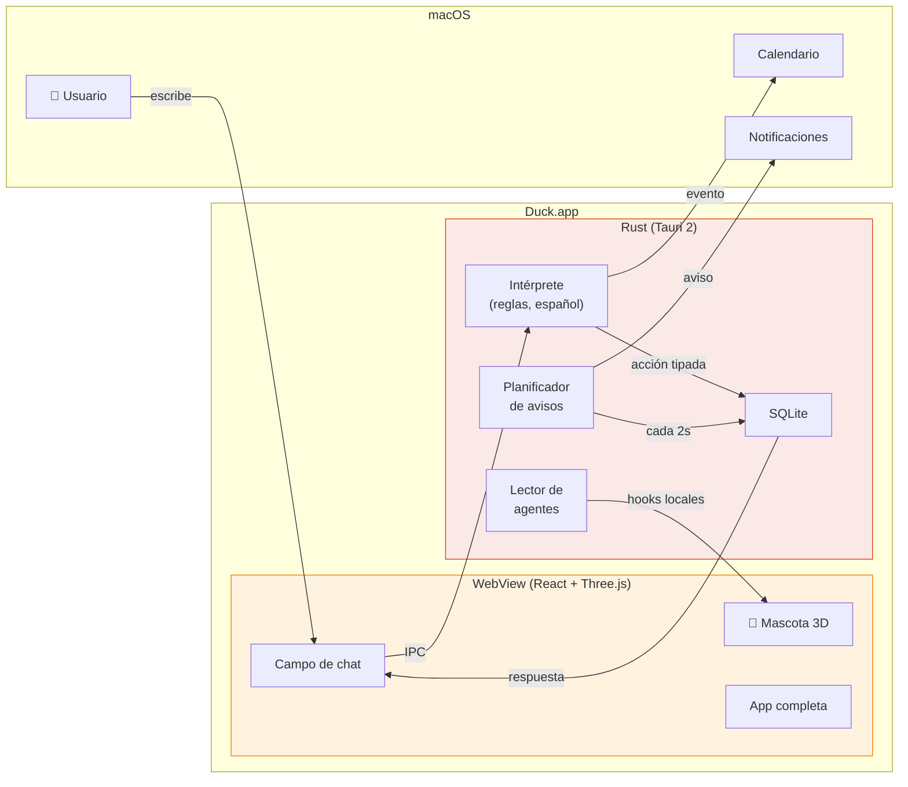
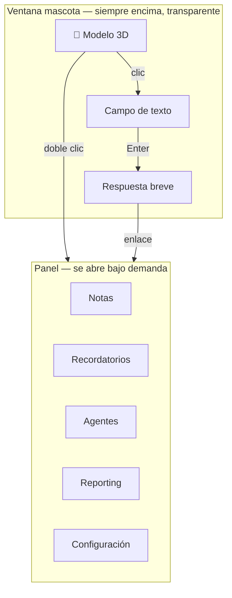
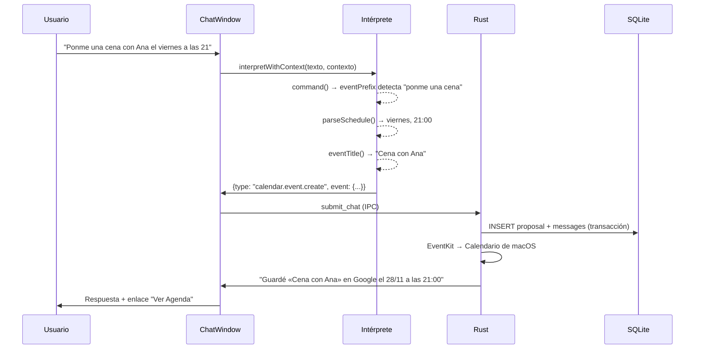

<p align="center">
  
</p>

<h1 align="center">Duck</h1>
<p align="center"><strong>Un patito 3D para tu escritorio de macOS</strong></p>

<p align="center">
  <a href="LICENSE"></a>
  
  
  
  
  
</p>

<p align="center">
  Mascota de escritorio que flota sobre tus ventanas y te ayuda con notas,<br>
  recordatorios, alarmas, eventos de calendario y el estado de tus agentes de código.<br>
  <strong>100 % local, sin IA generativa, sin cuentas.</strong>
</p>

<!-- 🖼️ Añade aquí un GIF o screenshot del pato en acción:
<p align="center">
  
</p>
-->

---

## Qué hace

| Función | Descripción |
|---------|-------------|
| **Notas** | Escribe «nota: lo que quieras» y se guarda al instante. |
| **Recordatorios** | «Recuérdame llamar a Ana mañana a las 9:30» — avisa con notificación nativa. |
| **Alarmas** | Un recordatorio que suena repetido hasta que lo paras o pospones. |
| **Eventos de calendario** | «Ponme una cena con Sara el viernes a las 21» — se guarda en el calendario de macOS que elijas. |
| **Resumen del día** | «Qué tengo hoy» — muestra eventos, recordatorios y notas del día. |
| **Borrar** | «Bórralo» deshace lo último; «borra la nota» o «borra el evento» son más específicos. |
| **Agentes** | Muestra en directo tus sesiones de Claude Code y Codex (estado, tareas, subagentes). |
| **Uso de IA** | Cuenta tokens y minutos por modelo leyendo historiales locales. Solo cifras, nunca texto. |
| **Dictado** | Reconocimiento de voz local de macOS, en español. |
| **Mascota 3D** | Accesorios, tamaño ajustable (64–480 pt), atajo global ⌘⇧D e icono en la barra de menús. |

### Ejemplos de lo que puedes escribirle

```text
nota: ideas para el próximo proyecto
Recuérdame en 10 minutos: hacer una pausa
Ponme una entrevista el lunes a las 10
Tengo médico el jueves a las 12
Pon una alarma mañana a las 7
Qué tengo hoy
Bórralo
Estado de agentes
```

Si falta un dato (la hora, el día, el título), Duck te lo pregunta en vez de adivinar.

---

## Arquitectura



### Dos ventanas, una sola app



### Flujo de una instrucción



---

## Requisitos

| Requisito | Detalle |
|-----------|---------|
| **Mac** | Apple Silicon (M1 o posterior). macOS 13+. |
| **Xcode CLI** | `xcode-select --install` |
| **Node.js** | 24 LTS o superior — [nodejs.org](https://nodejs.org) |
| **Rust** | 1.90+ — [rustup.rs](https://rustup.rs) |

---

## Instalar

No hay app precompilada: Duck no tiene firma de desarrollador ni notarización de Apple.
Compilarlo en tu Mac evita el aviso de Gatekeeper.

```bash
git clone https://github.com/user/duck.git   # ← sustituye por tu URL
cd duck
npm ci
npm run bundle          # la primera vez tarda varios minutos
```

Después, para tener una sola copia limpia:

```bash
codesign --force --deep --sign - src-tauri/target/release/bundle/macos/Duck.app
mkdir -p ~/Applications
ditto src-tauri/target/release/bundle/macos/Duck.app ~/Applications/Duck.app
rm -rf src-tauri/target/release/bundle/macos/Duck.app
open ~/Applications/Duck.app
```

La firma `–` es *ad hoc*, local a tu Mac. Para abrir Duck después: **⌘ Espacio → «Duck»**.

> **Consejo:** no clones dentro de `~/Documents` ni `~/Desktop` si tienes iCloud Drive — macOS puede mover archivos a la nube y las compilaciones se vuelven muy lentas. Usa una carpeta fuera de iCloud, por ejemplo `~/Developer`.

### Probarlo sin instalar

```bash
npm ci
npm run desktop         # abre Duck en modo desarrollo
```

`npm run dev` solo levanta la interfaz web — **no** incluye la base de datos ni las funciones nativas.

---

## Conectar Claude Code y Codex

Opcional. Sin esto Duck funciona igual, pero la pantalla *Agentes* queda vacía.

<details>
<summary><strong>Claude Code</strong></summary>

```bash
python3 scripts/install-claude-hooks.py --check
```

El script no modifica nada: comprueba que el hook funciona e imprime un bloque `"hooks"` con la ruta de **tu** copia del proyecto. Pégalo en `~/.claude/settings.json` (si ya tienes hooks, fusiona cada lista) y reinicia Claude Code.
</details>

<details>
<summary><strong>Codex</strong></summary>

El proyecto incluye `.codex/hooks.json`. Abre este proyecto en Codex, entra en **Ajustes → Hooks** y autoriza los avisos que quieras. Codex solo aporta el estado de cada turno.
</details>

<details>
<summary><strong>Qué se comparte</strong></summary>

El hook escribe un archivo pequeño por sesión en `/tmp/duck-agent-events-<tu uid>/` (carpeta privada, permisos `0700`) con: estado, nombre del proyecto, hora, y en Claude Code la petición recortada a 140 caracteres, títulos de tareas/subagentes y una cronología corta. **No guarda** el contenido de los comandos, archivos ni respuestas. Se borra a las 12 horas.
</details>

---

## Datos y privacidad

```
~/Library/Application Support/local.duck.companion/
├── duck.sqlite3      ← notas, recordatorios, mensajes, eventos
└── settings.json     ← preferencias y posición
```

- Duck **no cifra** los datos — dependen de FileVault y la protección de tu cuenta de macOS.
- Al guardar un evento, el título y las horas van al calendario elegido; macOS sincroniza la cuenta. Duck **no lee** tus eventos existentes.
- «Uso de IA» solo se activa manualmente en *Configuración*.
- Para backup: cierra Duck y copia la carpeta entera.

---

## Desarrollo

```bash
npm test              # pruebas del intérprete (Vitest)
npm run test:native   # pruebas de Rust
npm run build         # comprobación de tipos + empaquetado web
```

### Estructura del proyecto

```
src/
├── components/       # React: mascota, chat, panel, agentes, dictado
├── core/
│   ├── interpreter.ts    # clasificador por reglas (102 tests)
│   ├── api.ts            # frontera IPC tipada
│   ├── adapters.ts       # contratos para calendario/voz/eventos
│   └── types.ts          # tipos compartidos
├── main.tsx
└── styles.css

src-tauri/src/
├── main.rs           # punto de entrada y registro de comandos
├── storage.rs        # SQLite: esquema, CRUD, validación
├── chat.rs           # transacciones del chat, propuestas, undo
├── calendar.rs       # EventKit: guardar eventos en Calendario
├── notifications.rs  # planificador y entrega de avisos
├── alarm.rs          # alarma con sonido repetido y snooze
├── desktop.rs        # ventanas, bandeja, atajo, posición
├── agents.rs         # lector de hooks de Claude Code / Codex
└── usage.rs          # conteo de tokens y tiempo activo
```

Documentación técnica detallada: [ARCHITECTURE.md](ARCHITECTURE.md) · [ROADMAP.md](ROADMAP.md) · [docs/VERIFICATION.md](docs/VERIFICATION.md)

El proyecto [`ios/`](ios/README.md) es un esbozo de una versión para iPhone, sin firmar y sin probar en dispositivo.

---

## Limitaciones

- **Duck debe estar abierto** para que suenen recordatorios y alarmas. Con Duck cerrado o el Mac dormido no avisa.
- **El intérprete es por reglas**: no entiende frases completamente libres, varias acciones en una sola frase ni recurrencias.
- **Notificaciones**: macOS controla los permisos y el modo Concentración. Revisa *Ajustes del Sistema → Notificaciones → Duck*.
- **No notarizado**: no se puede distribuir como `.dmg` descargable sin firma Developer ID.
- El dictado y las alarmas dependen del audio y del reconocimiento de voz del Mac.

---

## Licencia

[GPL-3.0](LICENSE)
